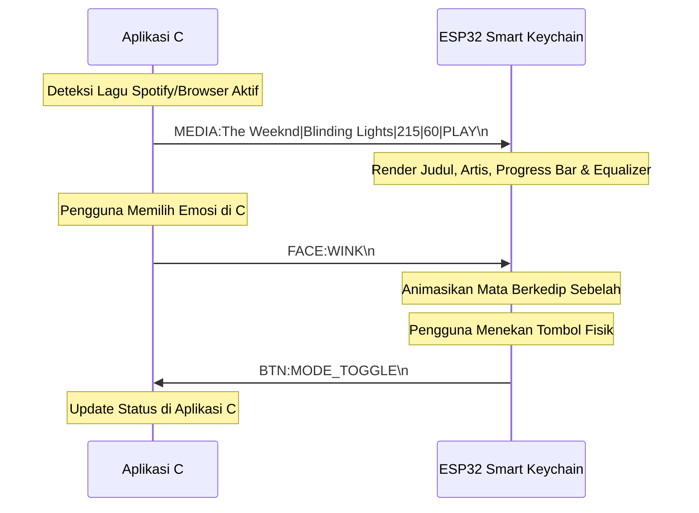
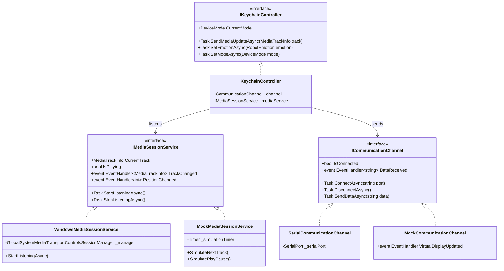

# Konteks Proyek: Smart Keychain (Cyber-Pet Robot Eye & Music Companion)

Dokumen spesifikasi teknis lengkap untuk proyek **Smart Keychain** bertema **Interactive Cyber-Pet & Music Display**. Perangkat ini berupa gantungan kunci mini interaktif berbasis mikrokontroler (ESP32) dengan layar mini (OLED / LCD Bulat) yang terhubung ke aplikasi desktop/laptop yang dikembangkan dengan **C# (.NET)**.

---

## 1. Visi & Konsep Produk

### 1.1 Deskripsi Produk
Bukan sekadar pelacak tag/beeper, **Smart Keychain** ini adalah **gadget pendamping saku & meja (*pocket/desk companion*)** yang memiliki dua fungsi utama:

1. **Mode 1: Expressive Robot Eyes (Cyber-Pet / Emosi Interaktif)**
   - Menampilkan animasi sepasang mata robot digital yang ekspresif (berkedip, melirik kiri-kanan, tersenyum, mengantuk, terkejut, berkedip sebelah / *wink*).
   - Mata merespons status komputer (misal: mata mengantuk saat laptop idle, mata berbinar/ceria saat ada musik diputar, atau mata pusing saat beban CPU tinggi).
   - Pengguna dapat mengganti ekspresi langsung melalui tombol fisik di gantungan kunci atau melalui dasbor aplikasi C#.

2. **Mode 2: Now Playing Music Display (Pemutar Musik & Media)**
   - Menampilkan informasi lagu yang sedang diputar di PC/Laptop (Spotify, YouTube, Apple Music, browser, atau media player lokal).
   - Menampilkan: **Judul Lagu (berjalan / *marquee scrolling*)**, **Nama Artis**, **Status Putar (Play/Pause)**, **Progress Bar Durasi Lagu**, dan **Animasi Visualizer Equalizer mini** yang bergerak mengikuti irama musik.

3. **Mode 3 (Bonus): Mini Status Monitor / Jam**
   - Menampilkan jam digital atau indikator performa PC (penggunaan CPU / RAM).

---

## 2. Kebutuhan Alat & Perangkat Keras (Bill of Materials - BOM)

Berikut rincian lengkap komponen perangkat keras, spesifikasi teknis, fungsi, dan estimasi harga pasar di Indonesia:

| No | Komponen / Alat | Rekomendasi Spesifikasi | Fungsi & Peran | Estimasi Biaya (IDR) |
|---|---|---|---|---|
| 1 | **Mikrokontroler Utama** | **ESP32 DevKit V1** atau **ESP32-C3 SuperMini** | Otak pemrosesan, kontrol display I2C/SPI, penerima data via Bluetooth Serial / USB | Rp 38.000 – Rp 65.000 |
| 2 | **Layar Mini (Pilihan A - Rekomendasi)** | **Layar OLED 0.96" I2C SSD1306 (128x64 pixel)** | Menampilkan mata robot pixel art, teks lagu, & equalizer. Hanya butuh 4 kabel (VCC, GND, SCL, SDA), sangat hemat daya | Rp 22.000 – Rp 30.000 |
| 3 | *Layar Mini (Pilihan B - Mewah)* | **Layar Bulat 1.28" Round LCD GC9A01 (240x240 IPS)** | Layar bulat IPS penuh warna, sangat menyerupai bola mata robot asli / smartwatch | Rp 45.000 – Rp 65.000 |
| 4 | **Tombol Interaksi (Push Button)** | 1x Tactile Micro Switch 6x6mm (atau Mini Button 4x4mm) | Mengganti mode tampilan (Robot Face $\leftrightarrow$ Music Info) & ganti emosi mata | Rp 1.000 – Rp 2.000 |
| 5 | **Buzzer Mini (Opsional)** | Passive Buzzer Mini 3.3V / Piezo Transducer | Menghasilkan suara *chirp* robot 8-bit lucu saat berganti emosi atau tombol ditekan | Rp 3.000 – Rp 5.000 |
| 6 | **Baterai Portabel** | Baterai Li-Po 3.7V (kapasitas 300mAh – 500mAh model pipih) | Sumber daya mandiri agar gantungan kunci dapat menyala tanpa kabel | Rp 20.000 – Rp 35.000 |
| 7 | **Modul Charger Baterai** | Modul TP4056 dengan Proteksi (Type-C) | Pengisian ulang daya baterai Li-Po melalui kabel USB-C standar | Rp 4.000 – Rp 7.000 |
| 8 | **Sakelar Daya (Slide Switch)** | Mini Slide Switch SPDT (1P2T) | Menghidupkan/mematikan daya baterai ke sistem | Rp 1.500 – Rp 3.000 |
| 9 | **Media Prototyping** | Mini Breadboard (170 / 400 titik) + Kabel Jumper | Merakit dan menguji rangkaian sebelum dipasang di wadah permanen | Rp 15.000 – Rp 20.000 |
| 10 | **Kabel USB Data** | USB Type-C atau Micro-USB (sesuai modul ESP32) | Upload firmware dan komunikasi serial kabel langsung | Rp 15.000 |
| 11 | **Casing Gantungan Kunci** | Enclosure Akrilik / Casing 3D Printed custom | Wadah berbentuk gantungan kunci dengan lubang rantai gantungan | Rp 15.000 – Rp 35.000 |
| **Total Estimasi** | | | **Perkiraan Biaya Total Hardware** | **Rp 120.000 – Rp 195.000** |

> **Catatan Komponen:** Untuk tahap awal di mata kuliah, penggunaan **Layar OLED 0.96" I2C SSD1306** sangat direkomendasikan karena dokumentasi library (U8g2 / Adafruit SSD1306) sangat melimpah, kabel sedikit (I2C), dan efisiensi baterainya tinggi.

---

## 3. Skema Sirkuit & Wiring Pinout (ESP32 + OLED 0.96")

### 3.1 Pemetaan Jalur I2C & Tombol (ESP32 Logic 3.3V)

```
        +-------------------------------------------------+
        |                   ESP32 DEVKIT                  |
        |                                                 |
        |  [3.3V]    --------------------> VCC OLED       |
        |  [GND]     --------------------> GND OLED       |
        |  [GPIO 22] --------------------> SCL OLED (I2C) |
        |  [GPIO 21] --------------------> SDA OLED (I2C) |
        |                                                 |
        |  [GPIO 19] --------------------> Kaki 1 Tombol  |
        |  [GND]     --------------------> Kaki 2 Tombol  |
        |            (Internal Pull-Up aktif)             |
        |                                                 |
        |  [GPIO 18] --------------------> (+) Buzzer     |
        |  [GND]     --------------------> (-) Buzzer     |
        |                                                 |
        |  [VIN/5V]  <--- Sakelar SPDT <-- TP4056 (OUT+)  |
        |  [GND]     <-------------------- TP4056 (OUT-)  |
        +-------------------------------------------------+
```

### 3.2 Penjelasan Perangkat Keras:
1. **Jalur Komunikasi Layar (I2C):** Pin `GPIO 21` (SDA) dan `GPIO 22` (SCL) adalah pin bus I2C default pada ESP32. Komunikasi I2C hanya membutuhkan 2 jalur data, sehingga sirkuit sangat rapi.
2. **Tombol Interaksi:** Tombol dihubungkan langsung ke `GPIO 19` dan `GND`. Dengan mengaktifkan `pinMode(19, INPUT_PULLUP)` di firmware, kita tidak perlu menambahkan resistor pull-up eksternal.
3. **Manajemen Daya Baterai:** Baterai Li-Po 3.7V terhubung ke pin `B+` dan `B-` pada charger TP4056. Keluaran `OUT+` melewati sakelar slide sebelum masuk ke pin `VIN` ESP32 (yang memiliki regulator step-down 3.3V internal).

---

## 4. Arsitektur Komunikasi & Format Protokol Data

Aplikasi C# mengirimkan instruksi ke gantungan kunci melalui **Bluetooth Serial (SPP)** atau **USB Serial (Virtual COM Port)** menggunakan format baris teks (*line-delimited commands*) yang ringkas dan cepat.



### 4.1 Perintah dari C# ke Gantungan Kunci

| Tipe Perintah | Format Payload | Keterangan |
|---|---|---|
| **Pembaruan Media Musik** | `MEDIA:<Artist>\|<Title>\|<DurationSec>\|<PositionSec>\|<State>\n`<br>*Contoh:* `MEDIA:Queen\|Bohemian Rhapsody\|354\|120\|PLAY\n` | Mengirim data lagu yang sedang diputar. ESP32 otomatis menggambar teks berjalan & progres bar. |
| **Ganti Wajah Robot** | `FACE:<EmotionName>\n`<br>*Contoh:* `FACE:HAPPY\n`, `FACE:SLEEPY\n`, `FACE:BLINK\n`, `FACE:DIZZY\n` | Memaksa layar beralih ke animasi mata sesuai emosi yang dipilih. |
| **Ganti Mode Display** | `MODE:<FACE/MUSIC/CLOCK>\n` | Mengatur mode aktif layar (Wajah Robot, Musik, atau Jam). |
| **Volume / Equalizer** | `EQ:<Bar1>,<Bar2>,<Bar3>,<Bar4>\n`<br>*Contoh:* `EQ:8,15,22,10\n` | Mengirim nilai tinggi bar equalizer untuk efek audio visualizer realtime. |

### 4.2 Data dari Gantungan Kunci ke C#

| Event String | Keterangan | Aksi di Aplikasi C# |
|---|---|---|
| `EVT:BTN:CLICK\n` | Tombol fisik ditekan sebentar | Berganti mode tampilan (Wajah $\leftrightarrow$ Musik) |
| `EVT:BTN:HOLD\n` | Tombol ditekan > 1.5 detik | Mengirim perintah Play/Pause kembali ke Spotify/PC |
| `EVT:DEVICE:READY\n` | ESP32 baru saja booting / pairing | C# segera mengirim sinkronisasi metadata pertama |

---

## 5. Arsitektur Perangkat Lunak C# (Mata Kuliah Pemrograman II)

Proyek perangkat lunak C# menggunakan pola **Clean Architecture & MVVM (Model-View-ViewModel)** dengan pemisahan library yang jelas.

### 5.1 Struktur Solusi (.sln) & Folder Proyek

```
smart-keychain/
├── firmware/
│   └── esp32_robot_keychain/
│       ├── esp32_robot_keychain.ino    # Program utama ESP32
│       ├── EyeRenderer.h               # Logika gambar vektor mata robot
│       └── MusicScreenRenderer.h       # Logika gambar judul lagu & equalizer
│
├── src/
│   ├── SmartKeychain.Core/             # Class Library (.NET Standard / .NET 8)
│   │   ├── Models/
│   │   │   ├── MediaTrackInfo.cs       # Data lagu (Artis, Judul, Durasi, Posisi)
│   │   │   ├── RobotEmotion.cs         # Enum emosi (Happy, Sad, Blink, Jamming)
│   │   │   └── DeviceMode.cs           # Enum mode (RobotEye, MusicVisualizer)
│   │   ├── Interfaces/
│   │   │   ├── IMediaSessionService.cs # Kontrak pembaca media OS (Spotify dll)
│   │   │   ├── ICommunicationChannel.cs# Kontrak komunikasi serial/bluetooth
│   │   │   └── IKeychainController.cs  # Kontrak controller gantungan kunci
│   │   ├── Services/
│   │   │   ├── KeychainController.cs
│   │   │   └── ProtocolFormatter.cs
│   │
│   ├── SmartKeychain.Hardware/         # Class Library
│   │   ├── Channels/
│   │   │   ├── SerialCommunicationChannel.cs # Menggunakan System.IO.Ports
│   │   │   └── MockCommunicationChannel.cs   # SIMULATOR untuk testing tanpa alat
│   │   └── Media/
│   │       ├── WindowsMediaSessionService.cs # Mengambil lagu dari Windows Media API
│   │       └── MockMediaSessionService.cs    # Simulasi lagu untuk Mac / Linux / Demo
│   │
│   ├── SmartKeychain.UI/               # UI Project (Avalonia UI / WPF)
│   │   ├── ViewModels/
│   │   │   ├── ViewModelBase.cs
│   │   │   └── MainViewModel.cs
│   │   ├── Views/
│   │   │   ├── MainWindow.axaml
│   │   │   └── Controls/
│   │   │       └── VirtualKeychainPreview.axaml # Preview layar OLED di dalam aplikasi
│   │   └── App.axaml.cs
│   │
│   └── SmartKeychain.Tests/            # Unit Testing Project
│       ├── ProtocolFormatterTests.cs
│       └── KeychainControllerTests.cs
│
├── PROJECT_CONTEXT.md
└── README.md
```

### 5.2 Penerapan Prinsip Berorientasi Objek (OOP)



1. **Abstraksi (`IMediaSessionService` & `ICommunicationChannel`):**
   - Menghubungkan aplikasi ke sistem media Windows via `WindowsMediaSessionService`.
   - Mengizinkan adanya `MockMediaSessionService` dan `MockCommunicationChannel` sehingga mahasiswa dapat menjalankan dan mendemokan aplikasi di **macOS atau laptop tanpa hardware fisik terpasang**, dengan simulasi layar OLED virtual di aplikasi C#!
2. **Polimorfisme:**
   - Objek `KeychainController` tidak peduli apakah data dikirim melalui kabel USB Serial fisik, Bluetooth SPP, atau mock channel.
3. **Pola Desain State & Observer:**
   - Menggunakan event-driven architecture untuk memperbarui UI dan layar gantungan kunci secara real-time setiap kali Spotify berpindah lagu tanpa melakukan polling berulang-ulang yang membebani CPU.

---

## 6. Desain Visual pada Layar OLED (Firmware Display Logic)

### 6.1 Tampilan Wajah Robot (Robot Eye Mode)
Layar OLED 128x64 dibagi menjadi dua bagian mata kiri dan kanan:
- **Ukuran Normal:** Kotak dengan sudut membulat berukuran 36x48 pixel untuk setiap mata dengan jarak antarmata 16 pixel.
- **Kedip (Blink):** Mata mengecil vertikal dari tinggi 48px $\rightarrow$ 24px $\rightarrow$ 4px $\rightarrow$ 24px $\rightarrow$ 48px dalam durasi 120ms.
- **Melirik (Look Left/Right):** Posisi pupil atau seluruh mata bergeser $X \pm 12\text{px}$.
- **Happy (Senyum):** Bagian bawah mata melengkung ke atas membentuk bulan sabit terbalik.
- **Jamming (Musik):** Mata memantul (*bouncing*) naik-turun mengikuti ketukan tempo lagu.

### 6.2 Tampilan Musik (Now Playing Mode)
Tata letak OLED 128x64 saat memutar musik:

```
+----------------------------------------+ (0,0)
| [> ] Blinding Lights                   | <- Baris 1: Ikon Play + Judul (Marquee)
| The Weeknd                             | <- Baris 2: Nama Artis
| ====================------------------ | <- Baris 3: Progress Bar Lagu
| 01:45 / 03:20            |||| || | ||| | <- Baris 4: Timer & Mini Equalizer
+----------------------------------------+ (128,64)
```

---

## 7. Rencana Minimum Viable Product (MVP) & Pengujian

### 7.1 Target Fitur MVP
1. **Fitur C# App:**
   - Mendeteksi media yang diputar di komputer (artis, judul, status).
   - Memilih port COM serial atau memilih "Simulasi Perangkat" (Mock Mode).
   - Tombol pilihan emosi mata robot (Normal, Senyum, Kedip, Jamming).
   - Layar *Virtual Keychain Preview* langsung di aplikasi C# (menampilkan persis apa yang seharusnya muncul di layar OLED fisik).
2. **Fitur Hardware ESP32:**
   - Menampilkan mata robot dan animasi kedip otomatis setiap beberapa detik saat idle.
   - Beralih ke layar musik saat menerima data paket `MEDIA:...`.
   - Tombol fisik untuk mengganti emosi / mode tampilan.

### 7.2 Skenario Pengujian (Test Cases)
| ID | Pengujian | Langkah | Hasil Diharapkan |
|---|---|---|---|
| TC-01 | Deteksi Media | Putar lagu di Spotify / YouTube | Judul dan artis otomatis muncul di aplikasi C# dan terkirim ke serial |
| TC-02 | Scroll Teks Panjang | Putar lagu dengan judul > 20 karakter | Layar OLED menampilkan teks berjalan (*marquee*) tanpa freeze |
| TC-03 | Tombol Ganti Wajah | Klik tombol "Happy" di aplikasi C# | Mata robot di layar langsung berganti menjadi mata tersenyum |
| TC-04 | Mock Mode di Mac/PC | Aktifkan Mock Channel tanpa ESP32 colok | Aplikasi berjalan 100% normal dan menampilkan preview grafis di jendela C# |
| TC-05 | Tombol Fisik | Tekan tombol pada breadboard ESP32 | Tampilan berganti antara Wajah Robot dan Informasi Musik |

---

## 8. Langkah Pengembangan (Roadmap)

- **Fase 1 (Software Core & Mock):** Buat solution C#, implementasikan `ProtocolFormatter`, buat `MockMediaSessionService` dan `MockCommunicationChannel`, lalu buat tampilan antarmuka C# dengan OLED Virtual Preview.
- **Fase 2 (Hardware Prototyping):** Rakit ESP32 dan OLED 0.96" di breadboard, buat sketsa Arduino C++ untuk menggambar mata robot dan teks musik.
- **Fase 3 (Integrasi Serial):** Hubungkan ESP32 ke laptop via USB/Bluetooth, tes pengiriman string serial dari aplikasi C# ke ESP32.
- **Fase 4 (Integrasi Windows Media):** Tambahkan `WindowsMediaSessionService` agar langsung tersinkronisasi otomatis dengan Spotify/YouTube laptop.
- **Fase 5 (Finishing):** Tambahkan baterai Li-Po dan sakelar, rapikan ke dalam kotak/casing gantungan kunci mini.
